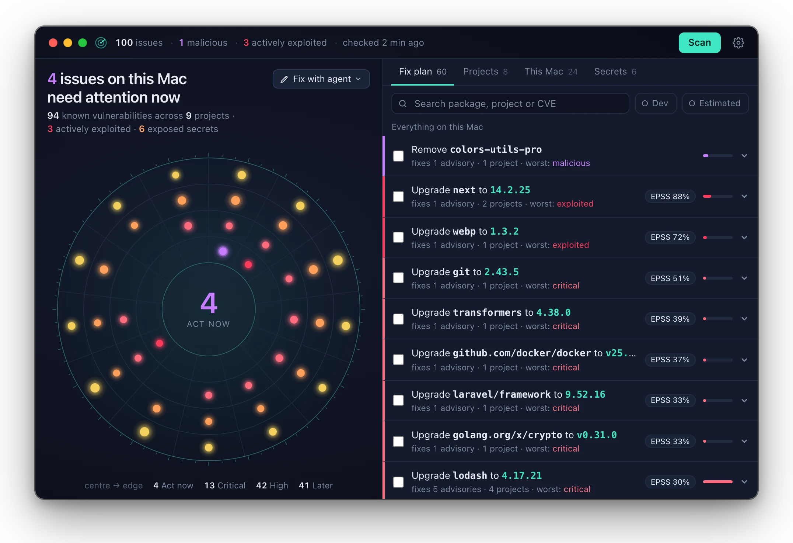
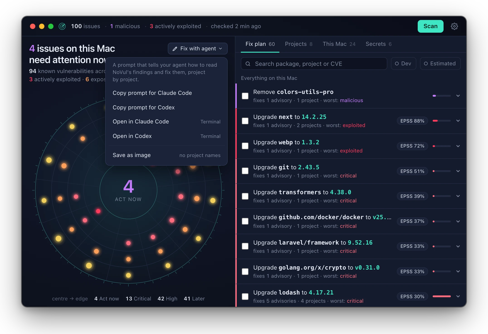
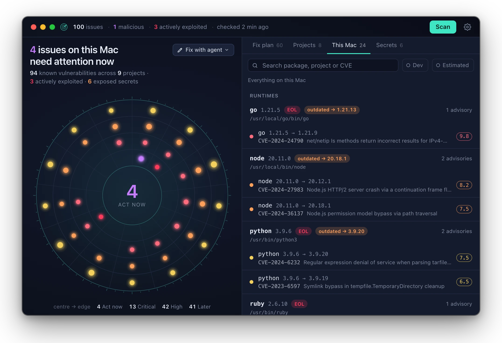
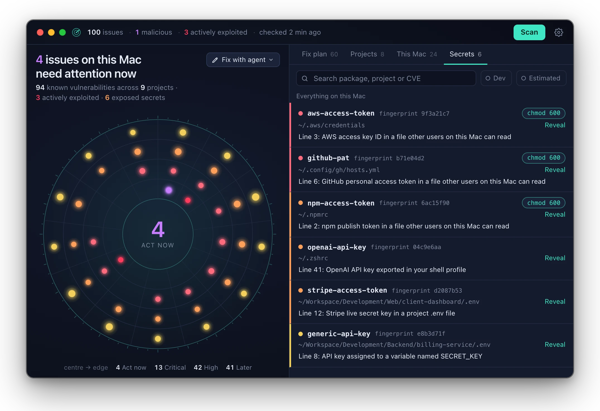
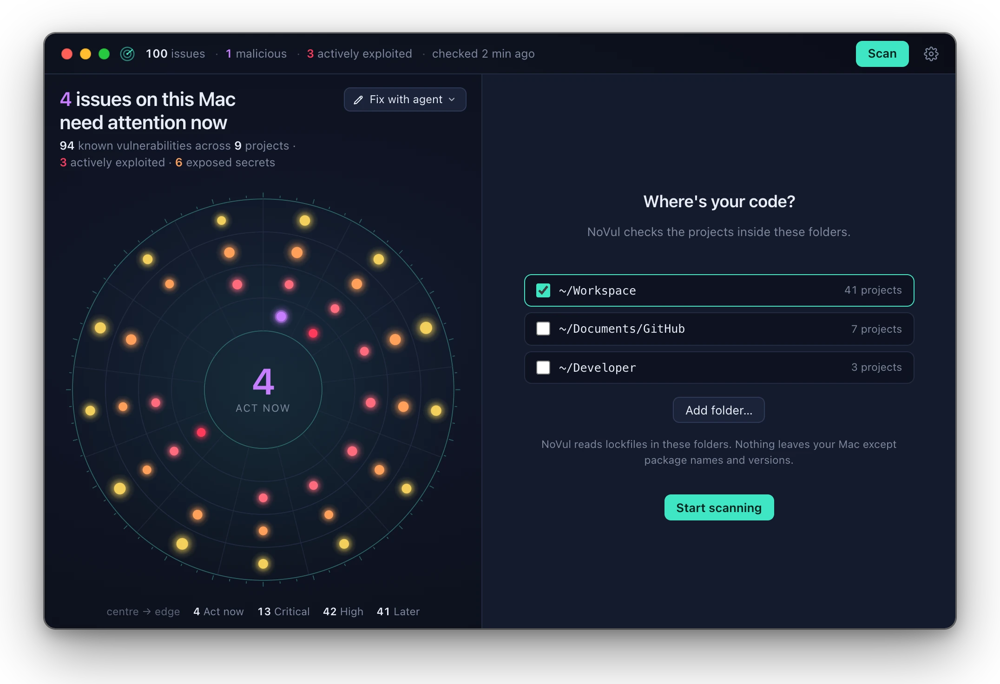

# NoVul

NoVul is a menu bar app for your Mac. It finds the security problems in the software on your Mac and tells you how to repair them.

<p>
  <a href="https://github.com/misbahsy/novul/releases/latest/download/NoVul-arm64.dmg"></a>
</p>
<p>
  <a href="https://github.com/misbahsy/novul/releases/latest"></a>
  
  <a href="LICENSE"></a>
</p>

- **Your projects.** Checks each package in your lockfiles against public vulnerability data.
- **This Mac.** Checks Homebrew packages, language runtimes, global packages and AI coding tools.
- **Exposed secrets.** Finds API keys in plain-text files.
- **Fix plan.** Shows what to fix first, with the command that fixes it.
- **Always current.** Checks again every 30 minutes and when a lockfile changes. Notifies you only
  about important problems.
- **Private.** Your code, files and keys stay on your Mac. Refer to [Privacy](#privacy).



<table>
  <tr>
    <td width="50%"></td>
    <td width="50%"></td>
  </tr>
  <tr>
    <td><b>Fix with agent.</b> Send all the problems to Claude Code or Codex in one prompt.</td>
    <td><b>This Mac.</b> The problems in your runtimes, Homebrew packages, global packages and AI tools.</td>
  </tr>
  <tr>
    <td></td>
    <td></td>
  </tr>
  <tr>
    <td><b>Exposed secrets.</b> The location of each key and how to make it safe. NoVul does not show the key.</td>
    <td><b>First start.</b> Select the folders that contain your code.</td>
  </tr>
</table>

<sub>The screenshots show the demo data of NoVul.</sub>

## What it checks

| Area | Details |
|---|---|
| Project packages | Lockfiles of npm, pnpm, Yarn, Bun, uv, Poetry, Pipenv, PDM, `requirements*.txt`, Composer, Go, Cargo, Bundler, Dart/Flutter and Mix. If a Python project has a `.venv` and no lockfile, NoVul reads the installed versions from the venv. |
| Homebrew | Installed formulae, with `brew vulns`. |
| Global packages | npm, pnpm and Bun globals, pipx and uv tools, `cargo install` packages, Go binaries and Ruby gems. |
| Runtimes | Node, Python, PHP, Go, Ruby and Java, including versions past end of life. |
| AI and developer tools | Claude Code, Codex, OpenCode, pi, Ollama and Bun, and the runtimes bundled in them. |
| Exposed secrets | API keys and tokens in project folders and common configuration files, found with [gitleaks](https://github.com/gitleaks/gitleaks). NoVul shows where a key is and how to move it, never the key. |

Vulnerability data comes from [OSV.dev](https://osv.dev), the GitHub advisories and
[endoflife.date](https://endoflife.date).

## How it ranks problems

1. **Malicious** packages.
2. Vulnerabilities that attackers **actively exploit**, from the
   [CISA KEV](https://www.cisa.gov/known-exploited-vulnerabilities-catalog) list.
3. All other vulnerabilities, from the highest severity to the lowest. If two have the same
   severity, the one with the higher [EPSS](https://www.first.org/epss) score is first.

A key for a service with a recent public data breach gets a higher priority.

## Install

You must have a Mac with Apple Silicon and macOS 13 or later.

1. [Download NoVul](https://github.com/misbahsy/novul/releases/latest/download/NoVul-arm64.dmg).
   For a different version, refer to [Releases](https://github.com/misbahsy/novul/releases).
2. Open the DMG file.
3. Drag NoVul to the Applications folder.
4. Open NoVul.
5. Select the folders that contain your code. NoVul shows the code folders that it found.

NoVul starts the first scan. The package results show in approximately 1 to 2 minutes. Then NoVul
does the check for exposed secrets.

NoVul shows only in the menu bar. It does not show in the Dock. When NoVul does not scan, it
uses approximately 20 MB of memory. Each scan runs in a separate process with a low priority. The process
stops when the scan is complete.

## Use it from your coding agent

NoVul has a CLI and an MCP server. Claude Code, Codex or a different agent can use them to:

- Read the problems in its repository.
- Repair the problems.
- Tell NoVul to do the scan again.

NoVul does not use AI and does not use API keys.

The fastest method is the **Fix with agent** button above the chart. This button copies a prompt for
Claude Code or Codex, or opens the prompt in Terminal. The prompt tells the agent to:

1. Read the problems from NoVul.
2. Repair the problems in each project.
3. Run your tests.
4. Tell NoVul to do the scan again.

To send only the problems of one project, select that project in the chart first.

To connect an agent to NoVul for all sessions, run this command:

```bash
claude mcp add novul -- /Applications/NoVul.app/Contents/MacOS/novul mcp
```

To show the problems of the project in your terminal folder, run this command:

```bash
/Applications/NoVul.app/Contents/MacOS/novul findings --project "$PWD"
```

To do a full scan from the terminal, run `novul scan --all`. This command does the same scan as
**Scan Now** in the menu bar: first the projects, then this Mac, then the secrets.

For Codex, OpenCode, the Claude Code skill and an AGENTS.md example, refer to
[agent/setup.md](agent/setup.md).

## Privacy

NoVul does not use an account. It does not send telemetry. It does not have a server.

NoVul downloads most of its data as full lists. These downloads do not send data from your Mac.
The lists are:

- The CISA list of exploited vulnerabilities.
- The FIRST EPSS scores for all CVEs.
- The end-of-life dates for all the runtimes that NoVul knows.
- The GitHub advisories for all the AI tools that NoVul knows.
- The Have I Been Pwned list of data breaches.

To find the vulnerabilities in your packages, NoVul has two modes:

| Mode | How NoVul checks your packages | Result |
|---|---|---|
| **Standard** (default) | Online. NoVul looks up package names and versions in the [OSV.dev](https://osv.dev) database. This includes your Homebrew packages and AI tools. For `requirements.txt` projects, NoVul also uses [deps.dev](https://deps.dev) to find the versions. | NoVul shows a new advisory in 30 minutes or less. |
| **Private mode** (in Settings) | On your Mac. NoVul downloads the OSV databases for your languages (approximately 250 MB, one time each day) and checks your packages against them. No data about your projects leaves your Mac. | NoVul shows a new advisory in one day or less. NoVul does not check Homebrew packages, because `brew vulns` must be online. |

NoVul does not send your source code, the contents of your files, your file paths or your secrets.
NoVul keeps the results in a SQLite database on your Mac, in
`~/Library/Application Support/dev.novul.app/`.

## Build from source

You must have [Rust](https://rustup.rs) and [Bun](https://bun.sh).

```bash
bun install
scripts/fetch-sidecars.sh
bun run tauri dev
```

- `fetch-sidecars.sh` downloads the correct versions of osv-scanner and gitleaks. It compares each
  file with `sidecars/SHA256SUMS`.
- `bun run tauri build` builds the app and the DMG file.
- `scripts/release.sh` builds, signs and notarizes the app and the DMG file. You must have an Apple
  Developer ID.
- To run the tests, go to `src-tauri` and run `cargo test --lib`.

## License

The license of NoVul is the [Apache License 2.0](LICENSE). NoVul contains osv-scanner (Apache 2.0)
and gitleaks (MIT). NoVul uses data from OSV.dev, CISA, FIRST, Have I Been Pwned (CC BY 4.0) and
endoflife.date. For more data, refer to [NOTICE](NOTICE) and
[THIRD_PARTY_LICENSES.md](THIRD_PARTY_LICENSES.md).
